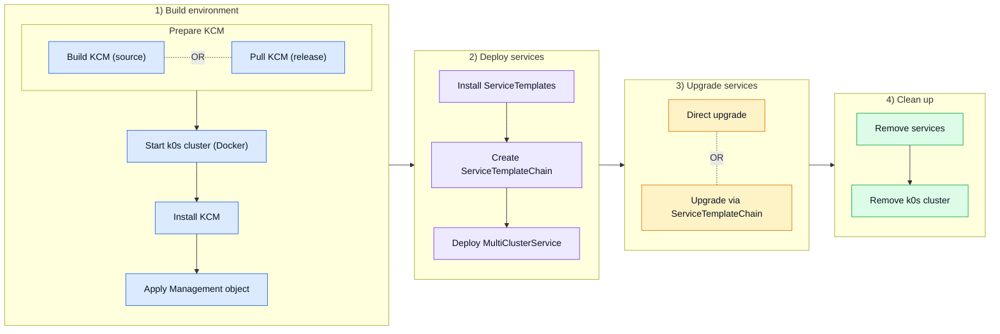

# k0rdent KSM Tests

Run different testing `Scenarios` on any [k0rdent KCM](https://github.com/k0rdent/kcm)
version (source or release).

## Modes
- **Local** - run tests locally in your machine (docker) for troubleshooting.
- **CI** - run tests in GitHub CI workflows.

## Testing Scenario Phases



## Where the services land
`TEST_MODE=self` (the default) keeps the environment as simple as possible: one
k0s cluster, no `ClusterDeployment`, KCM deploys the services into itself.

`TEST_MODE=adopted` builds a second k0s container and hands it to KCM as an
adopted `ClusterDeployment`, labelled `test_cld: adopted`, which the
`MultiClusterService` selects on. Slower, but it covers what self-management
cannot: the services landing on a cluster KCM reaches over the network.

`TEST_MODE=aws`, `azure` or `gcp` has k0rdent provision the cluster at the
provider. Same shape as adopted from the scenarios' point of view — a
`ClusterDeployment` carrying the same label — but it costs money and needs
credentials, so it is never part of a pull request. The ClusterDeployment
definitions, the credential charts and the checks that refuse to provision on
bad credentials are taken from [k0rdent/catalog](https://github.com/k0rdent/catalog);
see [`scripts/catalog/`](scripts/catalog/README.md) for what was copied and
what was not.

| mode | needs |
|---|---|
| `aws` | `AWS_ACCESS_KEY_ID`, `AWS_SECRET_ACCESS_KEY`, `AWS_REGION`, `AWS_EC2_FAMILY` |
| `azure` | `AZURE_SP_APP_ID`, `AZURE_SP_PASSWORD`, `AZURE_SP_TENANT_ID`, `AZURE_SUB_ID`, `AZURE_LOCATION` |
| `gcp` | `GCP_B64ENCODED_CREDENTIALS`, `GCP_PROJECT`, `GCP_REGION` |

A run picks one mode for everything; a scenario that only makes sense in one
of them says so with `testMode:` in its own file, and that wins. `e2e-serial.yml`
takes a list — `adopted, aws, gcp` — and runs one job per entry.

Everything is a shell script, same scripts run in CI and locally.

## Testing Scenarios

Each scenario builds a throwaway environment — one k0s cluster in Docker
running KCM — exercises one KSM behaviour and tears it down. Nothing is
provisioned: the services land either in KCM's own cluster or on a second k0s
container it adopts, depending on the mode above. No cloud credentials, no
cost.

| Scenario | Asserts |
|---|---|
| [`101_basic`](test_scenarios/101_basic.md) | one service reaches the child cluster and can be removed |
| [`201_svcdep`](test_scenarios/201_svcdep.md) | a `dependsOn` chain deploys in order |
| [`202_svcdep_invalid`](test_scenarios/202_svcdep_invalid.md) | an invalid service stops the rollout: nothing behind it runs, nothing before it is rolled back |
| [`301_upgrade`](test_scenarios/301_upgrade.md) | upgrading one service leaves the others untouched |
| [`302_upgrade_invalid_atomic`](test_scenarios/302_upgrade_invalid_atomic.md) | a failed atomic upgrade returns to the previous healthy state |
| [`401_mcsdep_valid`](test_scenarios/401_mcsdep_valid.md) | a dependent `MultiClusterService` waits for the one it depends on |
| [`402_mcsdep_invalid`](test_scenarios/402_mcsdep_invalid.md) | a broken dependency holds the dependent back for good |
| [`501_no_chain`](test_scenarios/501_no_chain.md) | with no `ServiceTemplateChain`, any version is reachable |
| [`502_chain_boundary`](test_scenarios/502_chain_boundary.md) | a chain offering nothing refuses every upgrade |
| [`503_direct_chain`](test_scenarios/503_direct_chain.md) | only what the chain lists is accepted |
| [`504_stepwise_chain`](test_scenarios/504_stepwise_chain.md) | a multi-hop chain is walked, not skipped |

Each runs against two KCM builds: `src: main` and `release: 1.12.0-rc.3`.

Install, `Management` reconcile and teardown are asserted too, because KSM
sits on them. Cloud provisioning is out of scope.

## Structure

```
test_scenarios/     one YAML per scenario -- the whole test definition
scripts/            the entry points below; everything you run by hand
  steps/            one script per pipeline step, 1:1 with the steps in CI
  utils/            subroutines the steps call; never run directly
  lib/              shared helpers; services.sh reads the scenario files
  config/           KCM values, the Management object, the CI matrix
  tests/bash/       unit tests for the scripts, no cluster needed
.github/workflows/  e2e.yml picks what to run, e2e-scenario.yml runs it --
                    one environment per scenario. e2e-serial.yml is separate:
                    one environment, every scenario on it in turn, on a pull
                    request here or by hand
```

## Running locally

### Create testing k0rdent cluster
~~~bash
# Create local k0s-in-docker cluster "k0rdent-<KCM>", deploy KCM
export KCM=1.12.0-rc.3 # (required), can be any release tag of OCI_URL chart
# ... export k0rdent cluster kubeconfig to kcfg_k0rdent and kcfg_k0rdent_<KCM>
# export TEST_MODE=self (default); "adopted" - second k0s cluster, adopted
#                                  # TODO later: "aws, azure, gcp"
# export KCM_MODE=release (default); "source" - build and deploy kcm from SRC_URL git, KCM ref (tag, branch, sha)
./scripts/deploy_k0rdent.sh
~~~

### Run scenario
~~~bash
# TEST_MODE has to match the one deploy_k0rdent.sh built, and does by default
# Run scenario on KUBECONFIG=kcfg_k0rdent
export SCENARIO=101_basic # (required) scenario id, fail for invalid, list available scenarios.
# export SCENARIO_KEEP=false (default) # optionally keep resources created by scenario 
./scripts/run_scenario.sh
# ./scripts/clean_scenario.sh # remove scenario objects (after SCENARIO_KEEP=true)
~~~

### Run several scenarios on the same cluster
~~~bash
# One cluster, one scenario after another, a summary at the end. The run stops
# at the first failure and says what it never got to.
export SCENARIOS="101_basic 201_svcdep"   # empty = every scenario
./scripts/run_scenarios.sh
~~~

### List available testing scenarios
~~~bash
./scripts/scenarios.sh
# 101_basic        # one service reaches the child cluster and can be removed
# 201_svcdep   # a `dependsOn` chain deploys in order
# ...
~~~

### List testing k0rdent clusters
~~~bash
# Every k0rdent-<KCM> cluster, and which one kcfg_k0rdent points at
./scripts/k0rdent_clusters.sh

# Switch the scenarios to another one
ln -sfn kcfg_k0rdent_1.12.0-rc1 kcfg_k0rdent
~~~

### Delete testing k0rdent cluster
~~~bash
# remove test environment (cluster) by given index (see ./scripts/k0rdent_clusters.sh output)
./scripts/remove_k0rdent.sh 1
~~~
