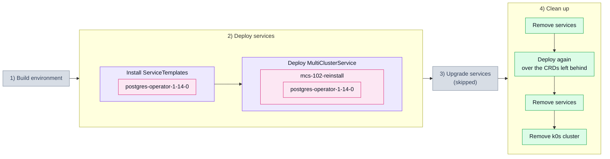

# 1.2. Reinstall over leftover CRDs (102_reinstall)

## Tested steps

1. Install the ServiceTemplate for `postgres-operator` and wait for it to report
   `valid`.
2. Deploy one MultiClusterService carrying that single service.
3. `postgres-operator` — deployed helm release in the child cluster, pods ready.
4. The MCS reports `ClusterInReadyState`.
5. Remove the services: MCS, ServiceSet, helm release and workloads all gone —
   except the CRDs, which helm leaves in the cluster on uninstall.
6. Install the whole thing again. The chart ships its CRDs in `crds/`, so this
   second install meets the ones the first left behind, and the
   `installOptions.existingCRDs` policy decides whether it proceeds. Sveltos
   overwrote the existing CRD until 1.17.0 and fails the install since.
7. Remove the services again, so the next scenario starts on an empty cluster.

## Scenario schema

Defined in [`102_reinstall.yaml`](102_reinstall.yaml).
